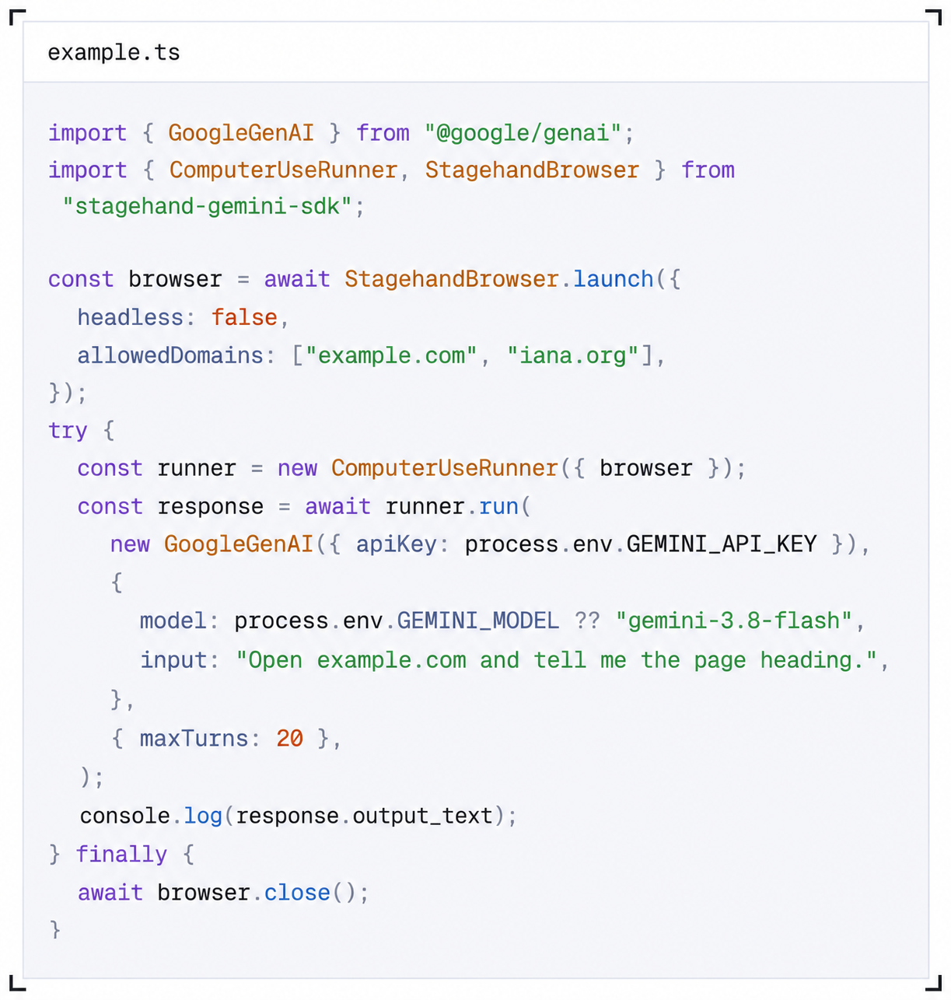
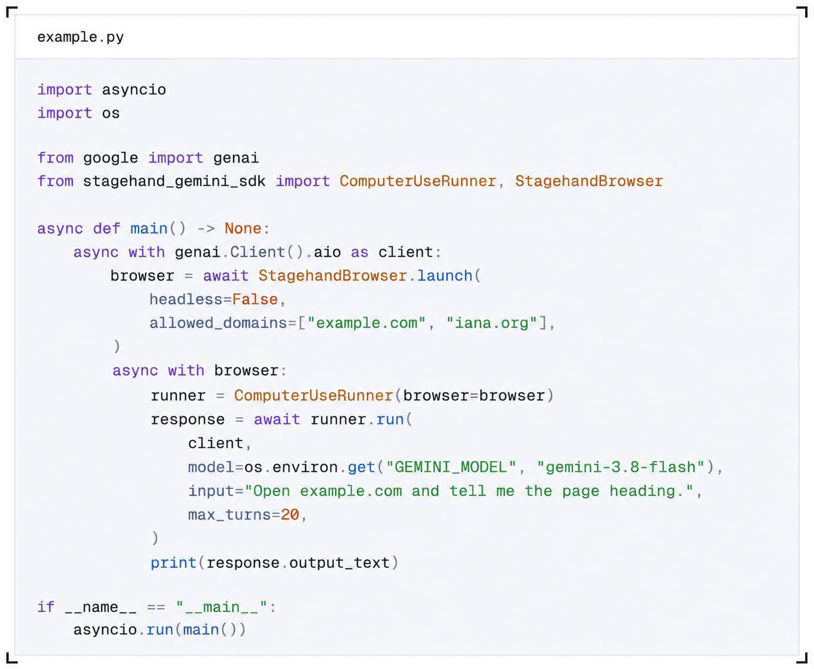

# Gemini toolset

Give Gemini a browser through the Google Gen AI SDK. `StagehandBrowser` uses [Stagehand](https://stagehand.dev) for navigation, screenshots, and page interactions. `ComputerUseRunner` handles the Gemini Interactions API's [Computer Use](https://aistudio.google.com/docs/computer-use) loop.

This repository contains TypeScript and Python quickstarts that import `stagehand-gemini-sdk`. The publishable SDK source lives in [`packages/typescript`](packages/typescript) and [`packages/python`](packages/python).

**TypeScript** · [`typescript/example.ts`](typescript/example.ts)

**Python** · [`python/example.py`](python/example.py)

## Choose your quickstart

| Language   | Guide                                         | Requirements            | Package                |
| ---------- | --------------------------------------------- | ----------------------- | ---------------------- |
| TypeScript | [TypeScript quickstart](typescript/README.md) | Node.js 22.18+ and pnpm | `stagehand-gemini-sdk` |
| Python     | [Python quickstart](python/README.md)         | Python 3.11+ and uv     | `stagehand-gemini-sdk` |

Both examples open `example.com`, ask Gemini for the page heading, and print the final answer. You'll need a Gemini API key and access to the model defined in the example.

Start with the language guide for setup and run commands. Until the first release, the examples use local workspace packages. See [publishing](PUBLISHING.md) for the package layout and release notes.

## Choose a browser

- **Local Chrome:** Run the examples as written. They launch a visible Chrome window, so install Google Chrome first.
- **Browserbase:** Replace `StagehandBrowser.launch` with `StagehandBrowser.browserbase` and provide a Browserbase API key. Both language guides show the replacement.

Keep the same browser instance throughout the tool loop. Close it when the task finishes or fails; the runner doesn't close it for you.

## Adapt the example

Change the task in `input`, set `GEMINI_MODEL` in `.env`, and update the allowed domains for your task.

| Setting           | TypeScript                           | Python                 |
| ----------------- | ------------------------------------ | ---------------------- |
| Import            | `stagehand-gemini-sdk`               | `stagehand_gemini_sdk` |
| Allowed domains   | `allowedDomains`                     | `allowed_domains`      |
| Blocked domains   | `blockedDomains`                     | `blocked_domains`      |
| Chrome executable | `chromePath`                         | `chrome_path`          |
| Model turn limit  | `maxTurns`                           | `max_turns`            |
| Cleanup           | `await browser.close()` in `finally` | `async with browser`   |

## Safety decisions

The runner enables Gemini's prompt injection detection. If Gemini requests confirmation, the runner stops unless your `confirm` callback explicitly returns `true` or `True`. Blocked and unknown safety decisions stop execution. Both language guides explain how to connect a confirmation UI.

## Limitations

- Domain policies apply to browser requests. Entries include subdomains, and blocked entries take precedence. This is a guardrail, not complete network isolation.
- Local browsers must be Chromium-based. Firefox and WebKit aren't supported.
- The SDK controls one page. It doesn't switch automatically to popups or new tabs.
- Mobile, desktop control, file transfers, and custom model tools aren't supported. Held keys and mouse buttons are excluded from the browser tool declaration.
- The Interactions API retains conversation state through `previous_interaction_id`. The runner doesn't retry requests or reconnect browsers.

## License

[MIT](LICENSE)
